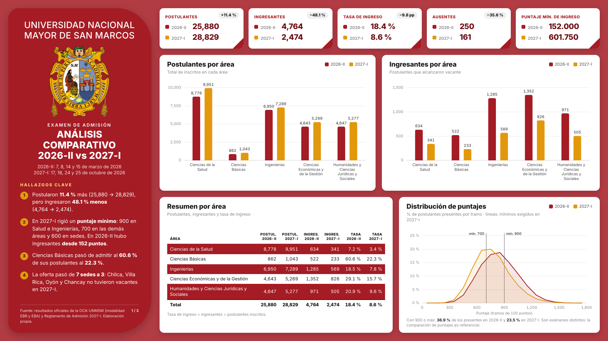
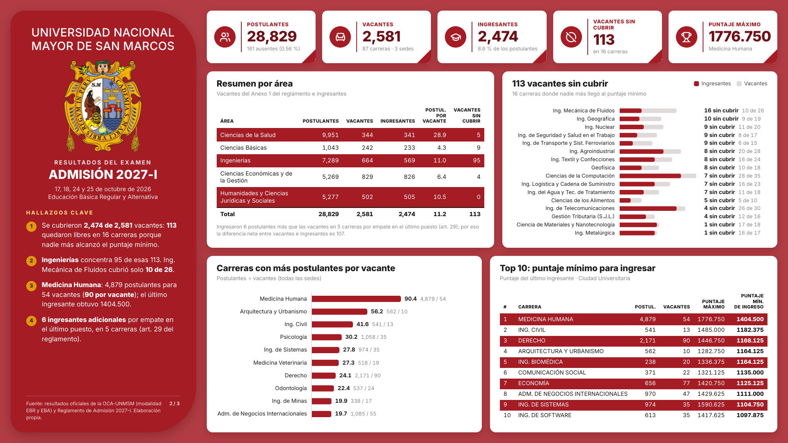
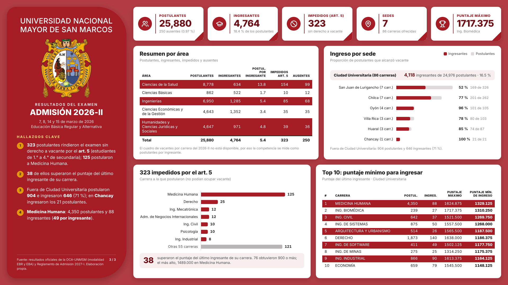

# Análisis comparativo de la Admisión UNMSM 2026-II vs 2027-I


Análisis de los resultados del examen de admisión de la **Universidad Nacional Mayor de San Marcos (UNMSM)**, en modalidad ordinaria (Educación Básica Regular y Alternativa), para dos procesos:

- **2026-II:** 7, 8, 14 y 15 de marzo de 2026. Fueron 25,880 postulantes, en 86 carreras y 7 sedes.
- **2027-I:** 17, 18, 24 y 25 de octubre de 2026. Fueron 28,829 postulantes, en 87 carreras y 3 sedes.

En total son **54,709 registros**. El cambio más importante entre los dos procesos es el **puntaje mínimo**. En 2026-II no hubo puntaje mínimo. En 2027-I el reglamento exigió 900 puntos en Ciencias de la Salud e Ingenierías, 700 en las demás áreas y 600 en las otras sedes.

---

## 📊 Hallazgos principales

| Métrica | 2026-II | 2027-I | Cambio |
|---|---|---|---|
| Postulantes | 25,880 | 28,829 | **+11.4 %** |
| Ingresantes | 4,764 | 2,474 | **−48.1 %** |
| Tasa de ingreso | 18.4 % | 8.6 % | −9.8 pp |
| Ausentes | 250 | 161 | −35.6 % |
| Puntaje del último ingresante (mínimo) | 152.000 | 601.750 | — |

- **Postularon más, pero ingresaron menos.** Antes ingresaba 1 de cada 5 postulantes; en 2027-I, 1 de cada 12.
- **113 de las 2,581 vacantes de 2027-I quedaron sin cubrir**, repartidas en 16 carreras, porque no hubo más postulantes que alcanzaran el puntaje mínimo. De esas 113, 95 son de Ingenierías. Por ejemplo, Ing. Mecánica de Fluidos cubrió solo 10 de sus 26 vacantes.
- **Medicina Humana** fue la carrera más disputada: 4,879 postulantes para 54 vacantes (90.4 por vacante). El último ingresante obtuvo 1,404.500 puntos.
- **Ciencias Básicas** fue el área que más cambió: pasó de admitir al 60.6 % de sus postulantes al 22.3 %.
- **La oferta pasó de 7 sedes a 3.** En 2027-I, Chilca, Villa Rica, Oyón y Chancay no ofrecieron vacantes.
- **2026-II, art. 5:** 323 postulantes rindieron el examen sin derecho a vacante (estudiantes de 1.° a 4.° de secundaria). De ellos, 125 postularon a Medicina Humana y 38 superaron el puntaje del último ingresante de su carrera.

> ⚠️ Los puntajes vienen de exámenes distintos, así que compararlos entre procesos es solo referencial.

---

## 🖼️ Visualización

**Análisis comparativo 2026-II vs 2027-I**


**Admisión 2027-I: vacantes, ingresantes y vacantes sin cubrir**


**Admisión 2026-II: resultados e impedidos por el art. 5**


---

## 📁 Estructura del repositorio

```
├── data/
│   ├── admision_unmsm_20262.csv      # Resultados 2026-II (25,880 registros)
│   └── admision_unmsm_20271.csv      # Resultados 2027-I (28,829 registros)
├── sql/
│   └── AdmisionUNMSM2026_2027.sql    # Script T-SQL completo (carga, modelo, vistas y validaciones)
├── images/                           # Páginas del dashboard (1920 × 1080)
├── LICENSE
└── README.md
```

### Diccionario de datos (CSV)

| Columna | Descripción |
|---|---|
| `cod_escuela` | Código de la carrera según la OCA. Las carreras de sede llevan un dígito extra; por ejemplo, `0911` es Administración en S.J.L. |
| `escuela` | Nombre de la carrera tal como lo publica la OCA. Las carreras de sede llevan un sufijo (` - S.J.L`, ` - HUARAL`, etc.). |
| `codigo` | Código del postulante. No incluye nombres. |
| `puntaje` | Puntaje final. Está vacío si el postulante estuvo ausente. |
| `merito` | Orden de mérito. Solo lo tienen quienes alcanzaron vacante. |
| `observacion` | Observación de la OCA: `ALCANZÓ VACANTE`, `AUSENTE` o `Articulo N° 5…`. |
| `ausente` | `True` / `False` |
| `alcanzo_vacante` | `True` / `False` |
| `articulo_5` | `True` / `False`. Solo aparece en 2026-II. |

---

## 🔄 Flujo del proyecto

```
Resultados publicados (OCA-UNMSM)
        │  Python (Playwright)
        ▼
   Archivos CSV  ── validados fila por fila contra la web de la OCA
        │  T-SQL (BULK INSERT + staging)
        ▼
 SQL Server · BD AdmisionUNMSM
        │  vistas
        ▼
   Análisis y visualización
```

El script de extracción no se incluye en este repositorio.

---

## 🗄️ Modelo de datos

| Objeto | Tipo | Descripción |
|---|---|---|
| `stg_20262`, `stg_20271` | Staging | Copia del CSV tal cual, todo como texto |
| `areas` | Dimensión | Las 5 áreas de admisión (A–E) |
| `facultades` | Dimensión | Las 87 carreras, con su facultad y su área |
| `sedes` | Dimensión | Las 7 sedes, con el sufijo que usa la OCA |
| `postulantes` | Hechos | Ambos exámenes en una sola tabla, con las columnas `examen`, `cod_escuela_base` (carrera sin sede), `cod_sede` y `estado` (calculada) |
| `vacantes_20271` | Hechos | Vacantes 2027-I por carrera y sede (Anexo 1 del Reglamento) |
| `vw_postulantes` | Vista | Postulantes con carrera, facultad, área y sede |
| `vw_postulantes_20262`, `vw_postulantes_20271` | Vista | `vw_postulantes` filtrada por examen |
| `vw_vacantes_2027` | Vista | Vacantes, ingresantes y vacantes no cubiertas por carrera y sede |

La columna `estado` toma uno de estos valores: `Ausente`, `Impedido (art. 5)`, `Ingresante` o `No ingresante`.

---

## 🚀 Cómo replicar

1. Usa **SQL Server 2017 o superior**, porque el script usa `BULK INSERT` con `FORMAT = 'CSV'`.
2. Crea la base de datos:
   ```sql
   CREATE DATABASE AdmisionUNMSM;
   ```
3. Descarga la carpeta `data/`. En la sección 2 del script, cambia `@ruta` por la carpeta donde guardaste los CSV (debe terminar en `\`). El servicio de SQL Server necesita permiso de lectura sobre esa carpeta.
4. Ejecuta `sql/AdmisionUNMSM2026_2027.sql` completo. La sección 8 devuelve las validaciones.
5. Para conectarlo a Power BI, entra a **Obtener datos → SQL Server**, escribe tu servidor, elige la BD `AdmisionUNMSM` y selecciona las vistas.

Ejemplo de consulta para ver las vacantes sin cubrir en 2027-I:

```sql
SELECT area, escuela, sede, vacantes, ingresantes, no_cubiertas
FROM vw_vacantes_2027
WHERE no_cubiertas > 0
ORDER BY no_cubiertas DESC;
```

---

## 📝 Notas metodológicas

- Solo se incluye la **modalidad ordinaria** (EBR y EBA).
- Se considera **ingresante** a quien tiene la observación `ALCANZÓ VACANTE`.
- Los postulantes de sedes se suman a su carrera base, con la sede en una columna aparte.
- En 2027-I, en 5 carreras ingresaron 6 postulantes más que las vacantes por empate en el último puesto (art. 29 del Reglamento). Por eso hay dos cifras: las vacantes vacías son 113, pero la diferencia neta entre vacantes e ingresantes es 107.
- No se consiguió el cuadro de vacantes por carrera de 2026-II. Por eso, para ese proceso la competencia se mide como postulantes por ingresante.
- El archivo de 2027-I no trae la columna `articulo_5`, así que se carga con 0.

**Fuentes:** resultados oficiales de la Oficina Central de Admisión (OCA) de la UNMSM y Reglamento de Admisión 2027-I (Anexo 1 de vacantes, puntajes mínimos y art. 29).

---

## ⚙️ Herramientas

Python (extracción) · SQL Server / T-SQL (ETL y modelado) · Git/GitHub

---

## 👥 Equipo

- Jose Maquera Martinez [LinkedIn](https://linkedin.com/in/josemaqueramartinez/)
- Sol Tasayco Robles [GitHub](https://github.com/TasaycoRoblesSol) - [LinkedIn](https://www.linkedin.com/in/tasayco-robles-sol-rosario/)
- Valeri Zavala Ipanaque [GitHub](https://github.com/ValeriYajahiraZavalaIpanaque) - [LinkedIn](https://www.linkedin.com/in/valeri-yajahira-m-zavala-ipanaque-1a54872a9/)

---
## 📧 Contacto

- **Email:** josemaqueramar@gmail.com
- **LinkedIn:** [Jose Maquera](https://linkedin.com/in/josemaqueramartinez/)  

---
## 📄 Licencia

Este proyecto está bajo la licencia [MIT](LICENSE).
